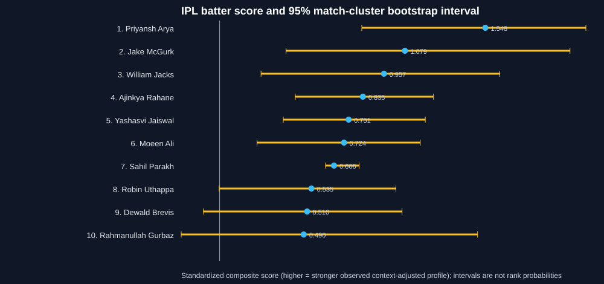
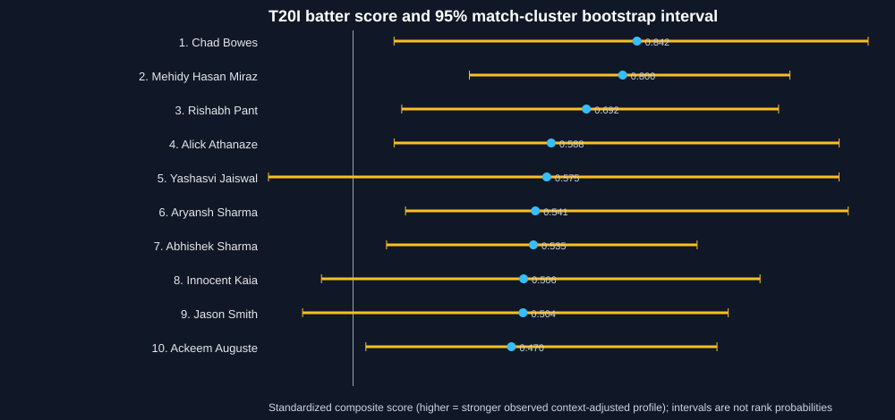

# Final competition methodology and results report

## Scope and decision

This audit uses only the supplied, accepted IPL and T20I data from 2022 onward and the completed Phase 1-5E outputs. IPL and T20I are analyzed independently; no cross-format score conversion or pooled ranking is used. The supplied data support two format-specific batter Top 10s under a declared contextual batting-resource definition. They do **not** support a reliable competition-ready bowling Top 10 under the unchanged evidence requirements. The required bowling list remains unsupported and must not be filled with exploratory profiles.

The ranking is an operational evaluation of performance in specified match contexts. It does not claim to measure a player's psychology or prove that the player felt pressure.

## Pressure definitions and comparison design

### Ranked batter context

For each format and innings phase, the pressure-context cohort uses wickets lost before the delivery at or above that phase-format's empirical 75th percentile (Q75); its reference uses wickets lost at or below Q25. Exact cutpoints from Phase 5C are: IPL powerplay 1/0, middle 4/1, death 6/3; T20I powerplay 1/0, middle 4/2, death 7/4 (pressure/reference wickets lost). Super Overs are excluded. Only match-by-phase strata containing both classes are paired. This represents batting-resource depletion at a comparable phase; it is a defensible batting challenge proxy, not verified scoreboard pressure. RRR > CRR is not mixed into this score.

### Separate verified chase validation

In regular second innings only, validated pre-delivery score, target, runs required, legal balls remaining and completed legal balls must permit CRR and RRR. Pressure is RRR > CRR; reference is RRR <= CRR. Unknown or ambiguous state is excluded, not imputed. This represents observable chase acceleration/containment demand, not psychological pressure. It remains a separate validation track and does not qualify a batter or bowler under current floors.

### Bowling challenge decision

Verified RRR > CRR is the strongest role-relevant bowling challenge available: a chasing batting side requires acceleration and the bowler's team faces a containment task. High wicket depletion alone is rejected as bowling pressure because a depleted batting lineup may make the task easier. Death phase, pace/spin, line/length proxies, speed and delivery descriptors do not establish pre-delivery match demand. No verified chase bowler profile meets both inherited pressure and baseline exposure floors.

## Batter metrics, baseline and score

On ordinary-delivery subsets, the batter components are (1) pressure-minus-baseline strike-rate change (60%); (2) baseline-minus-pressure dot-rate change (20%); and (3) pressure-minus-baseline boundary-event-rate change (20%). Baselines are the player's comparable low-depletion observations in paired match/phase context. These measures are limited feed subsets, not complete innings rates. Components are standardized within format and role before weighting.

The weighted standardized composite is reliability-shrunk by `n_eff / (n_eff + 20)`, where `n_eff` is the harmonic mean of pressure and baseline event counts. It is then multiplied by `0.5 + 0.5 × match_consistency_index`; the index is the average share of pressure matches in which the player's component beats their aggregate baseline. The k=20 shrinkage is a declared conservative choice, not a fitted parameter. Higher scores rank first, ties break by stable player ID. Format and candidate eligibility are kept separate.

Competition-ready batter floors remain unchanged: pressure at least 2 events across at least 2 matches, baseline at least 16 events across at least 3 matches. Phase 5D independently reconstructed all 305 eligible scores and rank order: 107 IPL and 198 T20I, maximum absolute score differences <4e-16, zero rank mismatches and zero floor failures. The final CSV contains the top ten of each independently reconstructed eligible pool.

### Final batter evidence table

The scores and uncertainty columns below come directly from the reconciled final CSV. Pressure/baseline exposures are events and distinct matches. Cluster intervals are uncertainty intervals on score, not rank probabilities.

| format | rank | player_name | score | pressure_events | pressure_matches | baseline_events | baseline_matches | score_ci95_low | score_ci95_high | stability_flag |
| --- | --- | --- | --- | --- | --- | --- | --- | --- | --- | --- |
| IPL | 1 | Priyansh Arya | 1.5476007603775104 | 63 | 6 | 305 | 28 | 0.8279875845658319 | 2.133158927511165 | stable_top10_candidate |
| IPL | 2 | Jake McGurk | 1.0794438211273263 | 31 | 5 | 127 | 14 | 0.3871105406739559 | 2.040621921069786 | stable_top10_candidate |
| IPL | 3 | William Jacks | 0.9571426644037139 | 122 | 16 | 53 | 9 | 0.2415031422026306 | 1.6314554922685531 | stable_top10_candidate |
| IPL | 4 | Ajinkya Rahane | 0.8345982004496483 | 329 | 38 | 407 | 43 | 0.4406945195731749 | 1.245705345356355 | stable_top10_candidate |
| IPL | 5 | Yashasvi Jaiswal | 0.7514301739875631 | 179 | 22 | 930 | 66 | 0.3709467516152844 | 1.1979770782256858 | stable_top10_candidate |
| IPL | 6 | Moeen Ali | 0.7243115119846978 | 159 | 18 | 29 | 6 | 0.21824676496408685 | 1.1686553642706865 | stable_top10_candidate |
| IPL | 7 | Sahil Parakh | 0.6661875041064236 | 12 | 2 | 21 | 3 | 0.6168430299287375 | 0.81216080342002 | stable_top10_candidate |
| IPL | 8 | Robin Uthappa | 0.5349104479075709 | 56 | 6 | 69 | 7 | -0.0022611814208937184 | 1.026622011656732 | stable_top10_candidate |
| IPL | 9 | Dewald Brevis | 0.5097841711576374 | 132 | 15 | 69 | 8 | -0.09428846203253795 | 1.0624680051019815 | method_or_sample_sensitive |
| IPL | 10 | Rahmanullah Gurbaz | 0.48959292409819943 | 89 | 7 | 122 | 16 | -0.22366540142495153 | 1.5023029541925508 | stable_top10_candidate |
| T20I | 1 | Chad Bowes | 0.8422000675822218 | 31 | 4 | 86 | 10 | 0.12161165309757471 | 1.528173790268499 | stable_top10_candidate |
| T20I | 2 | Mehidy Hasan Miraz | 0.7998743670148187 | 85 | 9 | 71 | 8 | 0.34507103449738474 | 1.2961532128422486 | stable_top10_candidate |
| T20I | 3 | Rishabh Pant | 0.6921964464598507 | 50 | 11 | 99 | 12 | 0.14446320343022215 | 1.2623568189063559 | stable_top10_candidate |
| T20I | 4 | Alick Athanaze | 0.5878210767016564 | 62 | 5 | 175 | 15 | 0.12198183502655045 | 1.442156662195266 | stable_top10_candidate |
| T20I | 5 | Yashasvi Jaiswal | 0.5745485738001743 | 34 | 4 | 293 | 19 | -0.25097317094397514 | 1.4419980481374461 | stable_top10_candidate |
| T20I | 6 | Aryansh Sharma | 0.5409743916355431 | 50 | 3 | 56 | 5 | 0.15547337881316634 | 1.4690609749377705 | stable_top10_candidate |
| T20I | 7 | Abhishek Sharma | 0.5349693453511407 | 275 | 29 | 673 | 55 | 0.09936735643034396 | 1.0206308932100254 | stable_top10_candidate |
| T20I | 8 | Innocent Kaia | 0.5062215461501977 | 50 | 5 | 89 | 9 | -0.0936903762779037 | 1.2073536908428937 | stable_top10_candidate |
| T20I | 9 | Jason Smith | 0.5043161954762564 | 21 | 5 | 28 | 3 | -0.149682974276403 | 1.1128923600820384 | stable_top10_candidate |
| T20I | 10 | Ackeem Auguste | 0.46976635169887543 | 39 | 5 | 32 | 6 | 0.03803445528539689 | 1.0796570276994448 | method_or_sample_sensitive |

### Score charts

Blue points show the composite score; gold bars show the 95% match-cluster bootstrap interval. Wide or overlapping intervals mean adjacent ranks are not statistically resolved.

## Uncertainty, stability and format separation

For each format's Top 10, Phase 5D used 1,000 stratified match-cluster bootstrap draws per candidate, jointly resampling shared pressure/baseline matches and separately sampling pressure-only and baseline-only match clusters; format standardization was held fixed. The intervals do not represent rank probabilities. Leave-one-match-out perturbations cover 359 paired IPL matches and 466 paired T20I matches; leave-one-season-out perturbations cover 5 IPL seasons and 8 T20I seasons. Under the disclosed stability flag (>=80% leave-one-match Top 10 retention and >=75% leave-one-season retention), 9/10 qualify in each format. Dewald Brevis (IPL) and Ackeem Auguste (T20I) are season-sensitive; both pass full-sample floors and remain included with flags. Rank proximity and bootstrap overlap caution against treating ordinal gaps as definitive.

Sensitivity in Phase 5C found Top 10 overlap of 9/10 for the 100/0/0 batter component weighting in both formats; IPL overlaps were 10/10 for 50/25/25 and 40/30/30, T20I overlaps were 9/10 for each. The threshold sensitivity is exploratory and does not change the inherited eligibility gates. Pressure-definition sensitivity is limited because the verified-state eligible pool is very small. No format scores are combined.

## Bowling evidence: available comparisons and blockers

Ordinary dots, ordinary batter runs/event and ordinary boundary events can be described on their restricted ordinary-delivery subsets; recognized bowler-credit wickets are divided by observed delivery rows (not legal balls). Full-scope ordinary rows cover about 94% of observed rows. The field coverage and denominators below reconcile to the Phase 5E metric-coverage file. High percentage availability of `legal_delivery` does not establish a complete validated per-bowler legal-ball denominator.

| format | metric | numerator_or_value | denominator | rate_or_coverage |
| --- | --- | --- | --- | --- |
| IPL | observed_delivery_event | 87687.0 | 87687.0 | 1.0 |
| IPL | ordinary_delivery_event | 82458.0 | 87687.0 | 0.9403674432926203 |
| IPL | recognized_bowler_credit_wicket | 4203.0 | 87687.0 | 0.04793184850662014 |
| IPL | legal_delivery_known | 87564.0 | 87687.0 | 0.9985972835197919 |
| T20I | observed_delivery_event | 106327.0 | 106327.0 | 1.0 |
| T20I | ordinary_delivery_event | 100089.0 | 106327.0 | 0.9413319288609666 |
| T20I | recognized_bowler_credit_wicket | 5702.0 | 106327.0 | 0.05362701853715425 |
| T20I | legal_delivery_known | 106188.0 | 106327.0 | 0.9986927121051097 |

Verified chase paired comparisons (higher dot rate and lower batter runs/boundaries are generally favorable to the bowling side; wicket yield is a separate observed-event ratio) are:

| format | metric | pressure_value | baseline_value | pressure_minus_baseline | cluster_ci95_low | cluster_ci95_high | paired_match_clusters |
| --- | --- | --- | --- | --- | --- | --- | --- |
| IPL | ordinary_batter_runs_per_event | 2.4375 | 0.6666666666666666 | 1.7708333333333335 | 1.125 | 3.5 | 3 |
| IPL | ordinary_boundary_rate | 0.375 | 0.0 | 0.375 | 0.2857142857142857 | 1.0 | 3 |
| IPL | ordinary_dot_rate | 0.25 | 0.3333333333333333 | -0.08333333333333331 | -0.5 | 0.375 | 3 |
| IPL | recognized_wicket_yield_per_observed_event | 0.05555555555555555 | 0.0 | 0.05555555555555555 | 0.0 | 0.14285714285714285 | 3 |
| T20I | ordinary_batter_runs_per_event | 1.8617021276595744 | 1.6987951807228916 | 0.16290694693668284 | -0.36947807069942223 | 0.6103477975697319 | 12 |
| T20I | ordinary_boundary_rate | 0.2978723404255319 | 0.27710843373493976 | 0.020763906690592138 | -0.10396505376344081 | 0.13842134593950575 | 12 |
| T20I | ordinary_dot_rate | 0.32978723404255317 | 0.40963855421686746 | -0.07985132017431429 | -0.2167144627065857 | 0.09700671505715651 | 12 |
| T20I | recognized_wicket_yield_per_observed_event | 0.07142857142857142 | 0.06741573033707865 | 0.004012841091492775 | -0.04846977427334571 | 0.04480804879199984 | 12 |

These aggregate contrasts have only 3 paired IPL match clusters (18 pressure / 4 baseline rows) and 12 T20I clusters (98 / 89 rows), all in powerplay. Their cluster-bootstrap intervals are broad, and no individual bowler meets inherited floors. Phase 5E outputs 0 competition-ready and 414 exploratory bowler profiles; neither the contextual wicket-depletion contrast nor the small RRR>CRR sample qualifies names for a ranked bowling list.

The format-level profile/exclusion accounting is:

| format | profiles | competition_ready | exploratory |
| --- | --- | --- | --- |
| IPL | 145 | 0 | 145 |
| T20I | 269 | 0 | 269 |

Every listed Phase 5C bowler profile remains exploratory. Under the role-valid verified-chase definition, **0** profiles meet both inherited pressure and baseline exposure floors in either format; contextual wicket-depletion numeric floor passes are excluded from competition-ready status because the challenge is not role-valid for bowlers.

Bowler-conceded runs cannot be reconstructed defensibly from available fields because extra type/amount and attribution are incomplete; complete legal-ball denominators also fail validation. Therefore economy and conventional bowling strike rate are blocked. Wickets are credited only under recognized dismissal rules, and this event yield does not repair the absent run/ball denominator. Available delivery attributes describe delivery type/execution but do not define a challenging situation in advance. Phase alone is a comparability control, not pressure. High wicket depletion is role-asymmetric and not accepted as bowling pressure.

## Candidate and exclusion accounting

| Role | Competition-ready | Exploratory | Submission status |
| --- | ---: | ---: | --- |
| Batter | 305 (IPL 107, T20I 198) | 17 | Separate format Top 10s supported under contextual batting definition |
| Bowler | 0 | 414 | No competition-ready Top 10 supported |

No candidates were promoted by lowering floors. Every final batter rank comes from the frozen Phase 5C file and was verified against Phase 5D reconstruction; all listed score, eligibility, exposure, sensitivity and limitation fields are in `final_batter_top10.csv`. Bowling comparisons, coverage, exposures and limitations are in `final_bowler_evidence.csv`.

## Limitations

The context definition is a wicket-resource proxy; it cannot isolate psychology, innings target difficulty, match importance or selection effects. Ordinary-delivery batting components omit extras and any unsupported attribution. Score standardization and weighting are model choices; the uncertainty analysis fixes standardization and leaves the contextual thresholds fixed. Bootstrap uncertainty is clustered by match but depends on a small number of independent matches for many individuals. Leave-one-season sensitivity is not threshold-recalibrated. Performance should not be inferred beyond the supplied IPL/T20I 2022-onward sample. No unsupported player claim, bowler score, complete bowling economy or psychological-pressure label is made.
